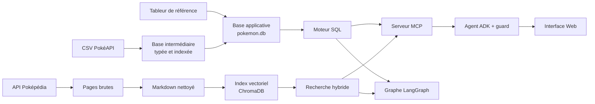

# Pokémon Agent

[](https://github.com/C-H-U-B/pokemon-agent/actions/workflows/ci.yml)

🇬🇧 [English version](README.md)

Un agent de questions-réponses en français, conçu pour rester fiable avec un petit modèle local. Le modèle choisit des outils, un contrôle déterministe vérifie chaque appel, et des campagnes d'évaluation mesurent l'effet des correctifs. L'agent s'appuie sur une chaîne de données qui collecte, nettoie et contrôle trois sources hétérogènes, puis les expose par un moteur SQL et une recherche documentaire. Il couvre tout le parcours, de la collecte des données au déploiement continu, et sert aussi de terrain pour prendre en main et comparer des outils du domaine.

Le projet se lance entièrement en local : SQLite, ChromaDB et un modèle Qwen 8B servi par LM Studio. La démo en ligne rejoue des réponses enregistrées.

## Démo en ligne

**[Essayer l'agent dans le navigateur](https://pokemon-agent-592924290447.europe-west1.run.app)** : l'interface Web, hébergée sur Cloud Run, en simulation. Elle rejoue des réponses réelles enregistrées (Gemini 3.8 Flash et Qwen3-VL 8B en local), avec leur graphe d'outils, leur onglet d'observabilité et leurs durées mesurées, sans appeler de modèle.

Ce qu'il faut savoir avant de l'essayer :

- Seules les questions proposées par les boutons « Débutant », « Joueur » et « Expert » ont une réponse ; la saisie d'une question est désactivée. Pour poser vos propres questions, utilisez le connecteur Claude ci-dessous ou lancez le projet en local.
- Les réponses s'affichent sans les illustrations des Pokémon, qui demanderaient la base.
- Le service s'arrête quand personne ne l'utilise et redémarre à la visite suivante.
- Rien n'est enregistré.

Le déploiement et ses réglages sont décrits dans le [guide de l'interface Web](src/pokemon_rag/web/README.md).

### Avec votre compte Claude

Les outils du projet (moteur SQL et recherche Poképédia) sont aussi servis comme connecteur MCP distant. Avec votre compte Claude, gratuit compris, vous posez vos propres questions : c'est Claude qui choisit les outils et rédige la réponse, à partir des données du projet.

1. Dans Claude.ai, ouvrez Paramètres → Connecteurs → « Ajouter un connecteur personnalisé ».
2. Donnez-lui un nom et l'URL `https://pokemon-mcp-592924290447.europe-west1.run.app/mcp`, puis cliquez sur « Connect » : l'autorisation est immédiate, aucun compte n'est demandé.
3. Activez le connecteur dans une conversation et posez une question, par exemple « Quel starter a la meilleure Défense Spéciale ? ».

À savoir : le service s'arrête au repos, et la première recherche documentaire qui le réveille peut prendre une à deux minutes ; les suivantes, quelques secondes. Le contrôle déterministe des arguments décrit plus bas protège l'agent local, pas ce connecteur. Détails dans le [guide MCP](src/pokemon_rag/mcp/README.md).

## En bref

| | |
| --- | --- |
| Sources | Une trentaine de fichiers CSV PokéAPI, un tableur de référence maintenu à la main, plus d'un millier de pages Poképédia |
| Base relationnelle | Quelques dizaines de tables, d'index et de vues ; des centaines de milliers de lignes d'apprentissage de capacités sur tous les groupes de jeux |
| Référentiel | Toutes les espèces, formes et capacités, environ un millier de chaque |
| Index documentaire | Des dizaines de milliers de fragments vectorisés |
| Tests | Tests unitaires, d'intégration et de bout en bout ; la plupart sans modèle, lancés en CI |

## Fiabiliser un petit modèle

Un modèle de 8 milliards de paramètres se trompe souvent sur les arguments : il oublie un filtre, invente une borne, remplace un nom rare par un nom plus courant. Plutôt que de lui faire confiance, un contrôle déterministe extrait les contraintes de la question et les compare à l'appel proposé avant son exécution. La réponse est contrôlée de la même façon : quand le modèle omet ou nie une ligne d'une liste reçue en entier, la réponse est remplacée par la liste construite depuis les données.

Les correctifs ont été mesurés avant et après sur une campagne de bout en bout avec Qwen3-VL 8B en local : davantage de questions réussies, des appels corrects dès la proposition du modèle bien plus souvent, et moins de réponses abandonnées pour dépassement de contexte. La campagne s'est ensuite enrichie de mots ordinaires qui ne doivent pas devenir des contraintes, de listes dont la réponse est contrôlée et de noms mal orthographiés.

Ce que vaut ce contrôle a été mesuré face à un agent généraliste, avec le même modèle et les mêmes outils : [OpenClaw](integrations/openclaw/), qui reçoit les règles d'usage dans son prompt mais aucun contrôle, s'est montré nettement moins fiable que l'agent sur les mêmes questions à contraintes de la campagne, en échouant sur les mêmes cas d'une exécution à l'autre (novembre 2026). Deux correctifs côté serveur, utiles à tout client, ont comblé l'essentiel de l'écart : un superlatif ne coupe plus un ex aequo, et les noms anglais ne sont renvoyés que sur demande. Les échecs restants, un argument oublié ou inventé et un nom mal écrit, ne se corrigent qu'en lisant la question : c'est le rôle du contrôle, que le serveur ne peut pas tenir. Proposer au modèle le nom proche d'un nom inconnu a été essayé puis retiré : OpenClaw ne relançait pas l'outil et inventait les statistiques du nom proposé.

Les traces enregistrent ce que le modèle a proposé, ce que le contrôle a corrigé ou refusé et ce qui a été exécuté. Les défauts qu'elles révèlent deviennent des cas de test, et les échecs sont classés avant correction en erreur de données, de test ou d'orchestration. Le récit complet est dans [l'historique de développement](DEVELOPMENT_FR.md).

## Flux de données



## La chaîne de données

### Données structurées : PokéAPI et tableur de référence

| Étape | Script | Ce qu'elle fait |
| --- | --- | --- |
| Collecte | `scripts/pokeapi/download_pokeapi.py` | Télécharge les CSV ; un fichier déjà présent n'est pas retéléchargé, et l'écriture passe par un fichier temporaire |
| Base intermédiaire | `scripts/pokeapi/build_pokeapi_db.py` | Importe les CSV avec des colonnes typées, crée les index et les vues de libellés |
| Base applicative | `scripts/pokeapi/build_pokemon_db.py` | Lit le tableur, relie chaque ligne aux identifiants PokéAPI et produit la vue `custom_pokedex` |

Le tableur et PokéAPI ne nomment ni ne découpent les formes de la même façon. Chaque ligne du tableur porte donc ses identifiants PokéAPI et un statut de correspondance. La construction vérifie que ces identifiants numériques existent, qu'ils sont cohérents entre eux et identiques dans les feuilles française et anglaise ; sinon, elle s'arrête.

### Données documentaires : Poképédia

| Étape | Script | Ce qu'elle fait |
| --- | --- | --- |
| Collecte | `scripts/pokepedia/download.py` | Interroge l'API du wiki avec un délai entre les requêtes ; une exécution interrompue reprend sans retélécharger |
| Nettoyage | `scripts/pokepedia/clean.py` | Convertit la syntaxe wiki en Markdown en conservant la hiérarchie des sections |
| Indexation | `scripts/pokepedia/ingest.py` | Découpe par section puis par taille, calcule les embeddings et alimente ChromaDB avec des identifiants de fragments déterministes |

Chaque fragment garde le Pokémon, le fichier source et le chemin de section dont il provient, ce qui permet de reconstruire une section complète au moment de la recherche.

## Qualité des données

- **Contrôles à la construction.** Chaque constructeur se termine par une validation qui interrompt la chaîne en cas d'anomalie : intégrité de la base, typage des colonnes de la plus grosse table, cohérence du rapprochement entre les feuilles française et anglaise, nombre d'espèces attendu.
- **Tests sur les données réelles.** Le rapprochement, les formes par défaut, les évolutions et les capacités sont vérifiés sur la base construite.
- **Tests sur catalogue contrôlé.** La logique SQL est testée sur de petites bases SQLite créées pour chaque test, avec des cas adverses : identifiants dans le désordre, valeurs nulles, égalités, formes manquantes.
- **Isolation.** Les tests légers échouent s'ils ouvrent les bases du projet ou chargent un modèle. Le moteur SQL n'importe aucun client de modèle, ce qu'un test vérifie.
- **Intégration continue.** À chaque push, GitHub Actions installe le projet sur une machine vierge, lance le contrôle statique et les tests qui ne dépendent ni des données locales ni d'un modèle.
- **Déploiement continu.** Quand les tests passent sur `main`, le même workflow construit l'image de simulation et la déploie sur Cloud Run en révision sans trafic. Le trafic ne bascule qu'une fois que la page de cette révision indique le mode simulation : aucun appel en direct au modèle ne peut partir. GitHub s'authentifie par Workload Identity Federation, sans clé de compte de service stockée.

Une anomalie de données rencontrée en cours de route illustre l'intérêt de ces contrôles : le jeu le plus récent n'utilise qu'une seule méthode d'apprentissage, si bien qu'une recherche de capacités par niveau y renvoyait une liste vide pour des centaines de Pokémon. La sélection du jeu tient désormais compte de la méthode demandée.

## Exposer les données

- **Moteur SQL.** Des fonctions paramétrées couvrent les évolutions, les capacités, les types, la recherche multicritère et les classements par statistique. Les filtres, les tris, les totaux et les égalités sont calculés en SQL. Le modèle de langage ne produit jamais de SQL : il choisit une opération et ses arguments.
- **Recherche documentaire.** Recherche lexicale et vectorielle combinées, prise en compte de la structure des sections, puis reclassement.
- **Serveur MCP.** Des outils typés exposent ces fonctions à n'importe quel client compatible : l'agent ADK, Claude.ai, [OpenClaw](integrations/openclaw/) sur Discord avec Qwen, ou un workflow [n8n](integrations/n8n/).
- **API HTTP.** Des routes exposent le moteur SQL sans aucun modèle. Elles réutilisent les fonctions des outils MCP : mêmes arguments, mêmes validations.

Trois façons de répondre à une question s'appuient sur ces mêmes données. L'agent ADK et son interface Web sont le parcours principal. Le graphe LangGraph et le client MCP sont la première version du projet, gardée pour comparaison et non maintenue : le graphe couvre moins d'opérations structurées que l'agent, mais il est le seul parcours à contrôler la fidélité d'une description.

| Parcours | Principe | Garanties |
| --- | --- | --- |
| Agent ADK et interface Web (principal) | Le modèle choisit les outils, un contrôle déterministe vérifie chaque appel | Arguments corrigés ou appel refusé, filtres non justifiés par la question retirés, réponses confrontées aux listes sur lesquelles elles s'appuient, budget de contexte mesuré |
| Graphe LangGraph (première version) | Routage entre SQL, recherche documentaire ou les deux | Plan contraint, contrôle de fidélité de la réponse, reprises bornées, abstention, traces |
| Client MCP (première version) | Boucle d'agent minimale écrite à la main | Contraintes explicites de la question préservées |

## Veille et intégrations

Le serveur MCP sert aussi de terrain pour évaluer d'autres outils du domaine :

- **OpenClaw** : client du serveur MCP, comparé à l'agent ADK sur les mêmes questions. La comparaison a conduit à deux correctifs du serveur.
- **n8n** : un agent de chat connecté au serveur MCP et un webhook vers l'API HTTP, avec un guide sur les cas où préférer n8n à du code.
- **LangGraph** : première version de l'agent (routage, contrôle de fidélité, abstention), conservée pour comparaison.
- **Contrôle d'accès MCP** : modèle de menace documenté et secret optionnel pour les déploiements privés. Le connecteur public reste ouvert par choix : ses outils sont en lecture seule sur des données publiques.

## Technologies

Python, SQLite, ChromaDB, Sentence Transformers, BM25, reclassement par CrossEncoder, LangGraph, Google ADK, Model Context Protocol, Gradio, FastAPI, Docker, Ollama, LM Studio, pytest, ruff.

## Lancer le projet

### Avec Docker, sans rien construire

La base SQLite et l'index documentaire sont publiés dans les [versions du dépôt](https://github.com/C-H-U-B/pokemon-agent/releases). Docker suffit : aucun environnement Python à installer.

**L'API seule, sans modèle.**

```bash
curl -L -o data/pokemon.db https://github.com/C-H-U-B/pokemon-agent/releases/latest/download/pokemon.db
docker compose up --build api
```

L'API répond sur `http://localhost:8000/docs`, par exemple `http://localhost:8000/pokemon/Pikachu/types`. `http://localhost:8000/health` renvoie une erreur 503 tant que la base est absente. Sous Windows PowerShell, écrire `curl.exe` : `curl` y désigne une autre commande.

**L'interface Web avec Qwen.** La base se télécharge comme ci-dessus. L'index s'installe une fois dans un volume Docker, puis l'interface et le serveur de modèle démarrent ensemble :

```bash
docker compose run --rm --no-deps web python -c "import tarfile, urllib.request; tarfile.open(fileobj=urllib.request.urlopen('https://github.com/C-H-U-B/pokemon-agent/releases/latest/download/chroma_db.tar.gz'), mode='r|gz').extractall('/app', filter='data')"
docker compose up --build web ollama
```

L'interface est sur `http://localhost:7860`. Au premier démarrage, Ollama télécharge Qwen3-VL 8B (6,1 Go) et l'interface attend qu'il soit prêt ; les deux modèles de recherche (930 Mo) sont récupérés à l'ouverture de la page. Avec une carte NVIDIA, lancer `docker compose -f compose.yaml -f compose.gpu.yaml up --build web ollama`.

Configuration sur laquelle cet ensemble a été mesuré : 10 Go de mémoire accordés à Docker et une carte graphique de 6 Go. Avec 8 Go, le modèle sature la mémoire et sa génération tombe sous un token par seconde. Compter une quinzaine de gigaoctets de disque. Le fonctionnement sans carte graphique n'a pas été mesuré.

Pour brancher l'interface sur LM Studio ou un autre serveur compatible OpenAI, voir le [guide de l'interface Web](src/pokemon_rag/web/README.md).

### En local

Prérequis : Python 3.10 ou plus récent, et un serveur de modèle compatible OpenAI pour les parcours qui appellent un modèle. Par défaut, LM Studio sur `http://localhost:1234/v1` avec `qwen/qwen3-vl-8b` (fenêtre de contexte de 16 384 tokens) ; `LLM_BASE_URL`, `LLM_MODEL` et `LLM_API_KEY` permettent d'utiliser Ollama, un autre hôte ou une API distante.

```bash
pip install -e .
```

Construire les données (voir [le guide des scripts](scripts/README.md) avant de relancer une construction, qui remplace les ressources existantes) :

```bash
python scripts/pokeapi/download_pokeapi.py
python scripts/pokeapi/build_pokeapi_db.py
python scripts/pokeapi/build_pokemon_db.py
python scripts/pokepedia/download.py
python scripts/pokepedia/clean.py
python scripts/pokepedia/ingest.py
```

Interface Web, puis graphe en ligne de commande :

```bash
python -m pokemon_rag.web.app
python -m pokemon_rag.graph.graph
```

Tests sans modèle ni données locales, et contrôle statique :

```bash
python -m pytest -m "not real_data and not llm and not models"
ruff check .
```

## Limites connues

- La base applicative et l'index documentaire sont publiés ; la base PokéAPI intermédiaire et le corpus brut restent à reconstruire pour les régénérer.
- Sur le parcours de l'agent, les listes structurées sont confrontées aux données, mais rien ne vérifie qu'une description est fidèle aux passages trouvés : elle peut recopier une fiche hors sujet ou extrapoler. Seul le graphe LangGraph contrôle cette fidélité.
- Les contrôles de réponse sont lexicaux : ils voient un nom absent ou déformé et les négations courantes, pas toutes les tournures, et les listes de plus de 30 lignes ne sont pas contrôlées.
- L'agent refuse une question qui mêle une description et un fait structuré ; il faut poser les deux séparément.
- Les étapes de construction se lancent à la main, dans l'ordre ci-dessus, et reconstruisent tout.
- L'intégration continue ne couvre pas les tests qui demandent les bases construites ou un modèle.
- Les mesures de bout en bout dépendent d'un modèle local ; elles sont relancées manuellement.
- Les campagnes ont aussi servi à mettre au point les correctifs, et aucun jeu de test n'est tenu à part : leur résultat ne mesure pas la généralisation à de nouvelles questions.
- Un run de campagne n'enregistre pas le commit sur lequel il a tourné.

## Documentation

- [Architecture](ARCHITECTURE.md) : flux, points d'entrée et frontières entre modules.
- [Scripts et données](scripts/README.md) : chaînes de préparation.
- [Moteur structuré](src/pokemon_rag/structured/README.md), [recherche documentaire](src/pokemon_rag/rag/README.md), [serveur MCP](src/pokemon_rag/mcp/README.md), [agent ADK](src/pokemon_rag/agent/README.md), [interface Web](src/pokemon_rag/web/README.md).
- [Tests](tests/README.md) : quelle validation lancer selon la modification.
- [Historique de développement](DEVELOPMENT_FR.md) : décisions, problèmes rencontrés et corrections, dans l'ordre chronologique.

## Licence et crédits

Le code et le tableur de référence sont distribués sous [licence MIT](LICENSE). Cette licence ne couvre pas les données tierces :

- **PokéAPI** : les données de jeu de la base proviennent de [PokéAPI](https://github.com/PokeAPI/pokeapi).
- **Illustrations des Pokémon** : les images affichées avec les réponses sont des illustrations officielles © Nintendo, Game Freak et The Pokémon Company, liées depuis le dépôt public [PokeAPI sprites](https://github.com/PokeAPI/sprites) et non redistribuées.
- **Poképédia** : les textes du corpus documentaire et l'index qui en dérive proviennent de [Poképédia](https://www.pokepedia.fr) et restent sous licence [CC BY-NC-SA 3.0](https://creativecommons.org/licenses/by-nc-sa/3.0/deed.fr) : attribution, pas d'utilisation commerciale, partage dans les mêmes conditions.

Pokémon et les noms associés sont des marques de Nintendo, Game Freak et The Pokémon Company. Ce projet est non officiel et sans but commercial.
