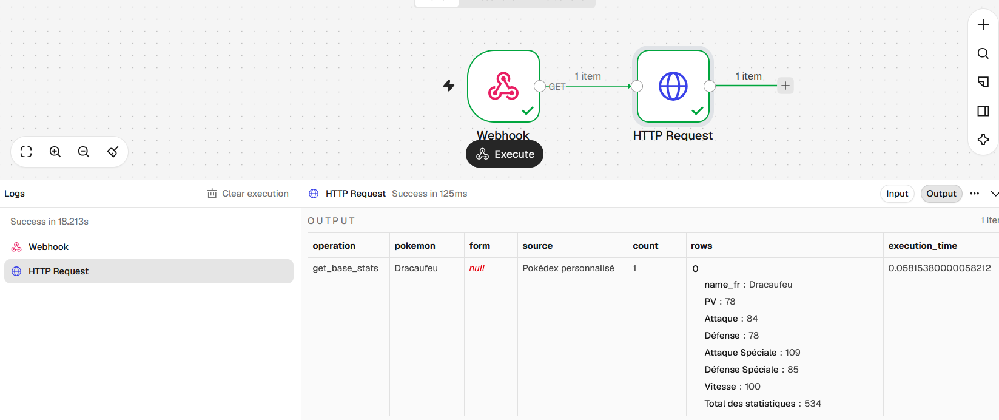

# n8n autour du serveur MCP et de l'API

n8n orchestre des workflows : déclencheurs, connecteurs et nœuds d'IA reliés dans un
éditeur visuel. Ici, il reste **autour** de l'agent, sans une ligne de code, avec deux
workflows à importer (menu **Import from File**) :

| Workflow | Chaîne | Modèle |
| --- | --- | --- |
| [`chat-agent-mcp.json`](chat-agent-mcp.json) | Chat Trigger → AI Agent → serveur MCP (douze outils) | Qwen dans LM Studio |
| [`webhook-api.json`](webhook-api.json) | Webhook → requête HTTP vers l'API (`/pokemon/{nom}/stats`) | aucun |

À l'import, n8n demande de recréer les deux credentials du premier workflow : ni clé ni
jeton ne sont exportés.

## Agent Qwen avec le serveur MCP


À « Quels sont les types de Dracaufeu ? », Qwen appelle `pokemon_types` avec
`pokemon="Dracaufeu"`, le serveur répond en 137 ms depuis la base, puis Qwen formule
« Feu et Vol » : 14 s et environ 9 600 tokens au total, surtout les schémas des outils
(16 novembre 2026, n8n 2.47.7). Le message système reprend les règles d'usage données à
[OpenClaw](../openclaw/AGENTS.md).

1. Serveur MCP en HTTP, sur toutes les interfaces : n8n tourne dans Docker et appelle
   `host.docker.internal`, un hôte que le SDK MCP refuse quand le serveur n'écoute que
   sur 127.0.0.1.

   ```powershell
   $env:MCP_AUTH_TOKEN = python -c "import secrets; print(secrets.token_urlsafe(32))"; $env:MCP_AUTH_TOKEN
   $env:MCP_HOST="0.0.0.0"; $env:PORT="8001"; python -m pokemon_rag.mcp.server --http
   ```

2. n8n, un seul conteneur ; le volume garde le compte et les workflows :

   ```powershell
   docker run -it --rm --name n8n -p 5678:5678 -v n8n_data:/home/node/.n8n docker.n8n.io/n8nio/n8n
   ```

3. Credentials des deux nœuds :

   | Nœud | Réglage |
   | --- | --- |
   | OpenAI Chat Model | Base URL `http://host.docker.internal:1234/v1`, clé `lm-studio` ; **Use Responses API désactivé** (LM Studio sert `/v1/chat/completions`) |
   | MCP Client | Header Auth `Authorization` = `Bearer <valeur de MCP_AUTH_TOKEN>` |

   Le serveur écoute sur toutes les interfaces : définir `MCP_AUTH_TOKEN` dans son terminal
   avant de le lancer, et mettre la même valeur dans l'en-tête. Tout autre jeton, ou son
   absence, reçoit un 401. Sans cette variable, la façade OAuth accepte n'importe quel jeton
   (mode de la démo publique pour Claude.ai) : à réserver à un réseau privé.

## Webhook vers l'API, sans modèle



Le webhook transmet le nom reçu à l'API, qui répond en 125 ms ; aucun modèle n'intervient.
Le nom est encodé (`encodeURIComponent`) avant d'entrer dans le chemin : sinon un nom
contenant `/` ou `?` atteindrait une autre route de l'API.

```powershell
python -m uvicorn pokemon_rag.api.app:app --host 0.0.0.0 --port 8000
```

Après **Execute workflow** dans n8n :

```powershell
Invoke-RestMethod "http://localhost:5678/webhook-test/pokemon-stats?pokemon=Dracaufeu"
```

## Quand n8n plutôt que LangGraph ou ADK

n8n convient à ce qui entoure l'agent : déclencher une question depuis un webhook, un
formulaire, un e-mail ou une planification, et envoyer la réponse vers Slack, un CRM ou
un tableur, en le modifiant sans redéployer de code. Le cœur de l'agent reste en code
(LangGraph, ADK) dès que sa fiabilité repose sur une logique à tester : le guard qui
corrige ou refuse les arguments, le budget de contexte, les reprises et l'abstention.
Le nœud AI Agent de n8n n'a rien de tout cela. Avec les mêmes outils, le même modèle et
les mêmes règles dans le prompt, il se trouve dans la situation d'[OpenClaw](../openclaw/),
mesuré moins fiable que l'agent ADK sur les mêmes cas ; la mesure n'a pas été refaite
dans n8n.
