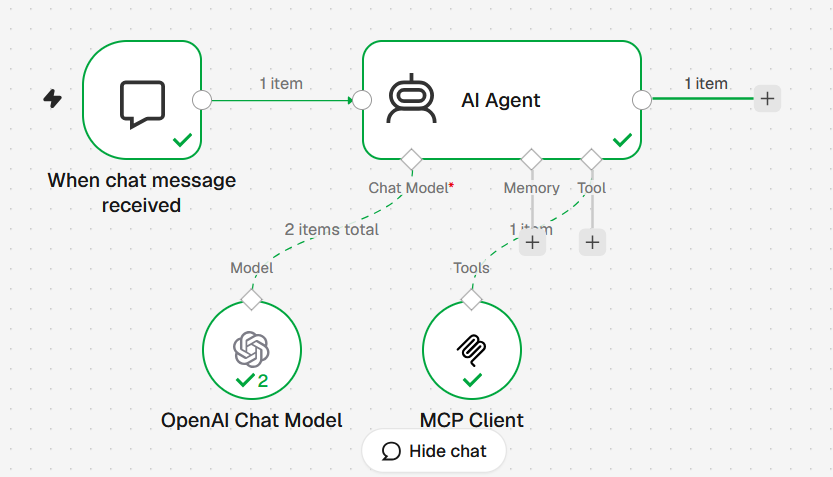
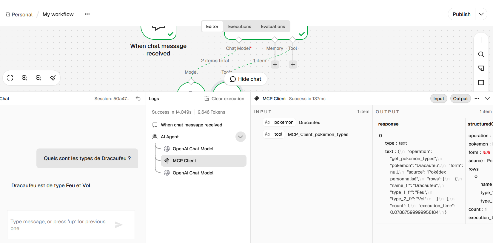

# n8n autour du serveur MCP

n8n orchestre des workflows : déclencheurs, connecteurs et nœuds d'IA reliés dans un
éditeur visuel. Ici, il reste **autour** de l'agent : un workflow n8n donne la parole à
Qwen et branche le serveur MCP du projet comme outil, sans une ligne de code.





`Chat Trigger → AI Agent`, avec sous l'agent le nœud **OpenAI Chat Model** (Qwen dans
LM Studio) et le nœud **MCP Client Tool** (les douze outils du serveur). À « Quels sont
les types de Dracaufeu ? », Qwen appelle `pokemon_types` avec `pokemon="Dracaufeu"`,
le serveur répond en 137 ms depuis la base, puis Qwen formule « Feu et Vol » : 14 s et
environ 9 600 tokens au total, surtout les schémas des outils (16 novembre 2026, n8n 2.47.7).

## Lancer

1. Serveur MCP en HTTP, sur toutes les interfaces : n8n tourne dans Docker et appelle
   `host.docker.internal`, un hôte que le SDK MCP refuse quand le serveur n'écoute que
   sur 127.0.0.1.

   ```powershell
   $env:MCP_HOST="0.0.0.0"; $env:PORT="8001"; python -m pokemon_rag.mcp.server --http
   ```

2. n8n, un seul conteneur ; le volume garde le compte et les workflows :

   ```powershell
   docker run -it --rm --name n8n -p 5678:5678 -v n8n_data:/home/node/.n8n docker.n8n.io/n8nio/n8n
   ```

3. Sur http://localhost:5678, construire `Chat Trigger → AI Agent`, puis sous l'agent :

   | Nœud | Réglage |
   | --- | --- |
   | OpenAI Chat Model | Credential : Base URL `http://host.docker.internal:1234/v1`, clé `lm-studio` ; modèle `qwen/qwen3-vl-8b` ; **Use Responses API désactivé** (LM Studio sert `/v1/chat/completions`) |
   | MCP Client Tool | Endpoint `http://host.docker.internal:8001/mcp`, transport HTTP Streamable, Header Auth `Authorization` = `Bearer n8n-local`, tous les outils |

   La façade OAuth du serveur accepte n'importe quel jeton, mais en exige un : sans
   en-tête, `/mcp` répond 401.

## Quand n8n plutôt que LangGraph ou ADK

n8n convient à ce qui entoure l'agent : déclencher une question depuis un webhook, un
formulaire, un e-mail ou une planification, et envoyer la réponse vers Slack, un CRM ou
un tableur, en le modifiant sans redéployer de code. Le cœur de l'agent reste en code
(LangGraph, ADK) dès que sa fiabilité repose sur une logique à tester : le guard qui
corrige ou refuse les arguments, le budget de contexte, les reprises et l'abstention.
Le nœud AI Agent de n8n n'a rien de tout cela. Avec les mêmes outils et le même modèle,
il se trouve dans la situation d'[OpenClaw](../openclaw/), mesuré à 9, 8 et 9 cas justes
sur 10 contre 10 pour l'agent ADK. Ce score n'a pas été remesuré dans n8n.
